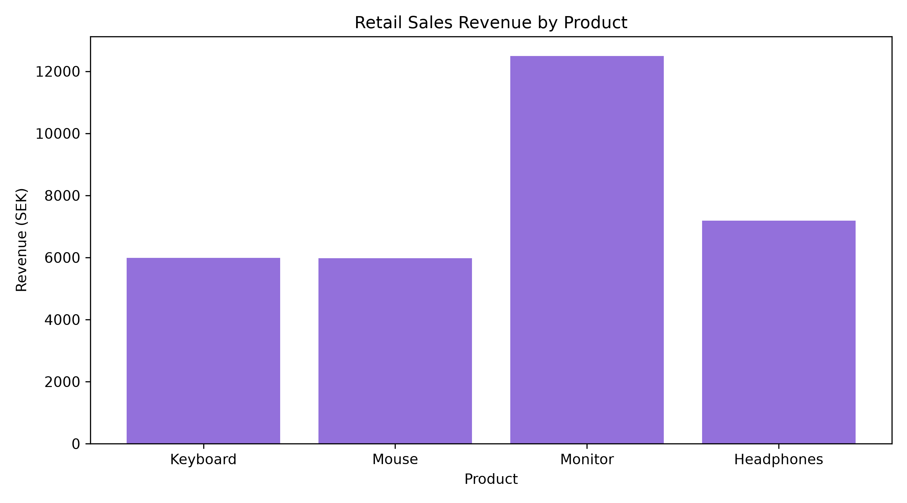
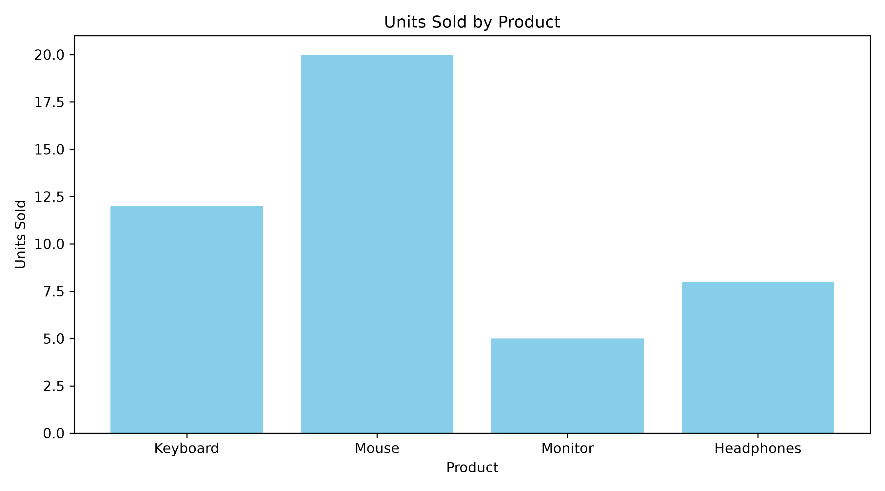

# Retail Sales Data Analysis with Python

## Project Overview

This is a beginner-friendly Data Science portfolio project
developed using Python, Pandas and Matplotlib.

The project analyses fictional retail sales data to identify
revenue patterns, compare product performance and visualise
business insights.

I created this project as part of my learning journey
while studying Data Science at EC Utbildning in Sweden.

## Objectives

- Analyse retail sales data using Python
- Calculate total revenue and units sold
- Identify the highest-revenue products
- Compare sales across product categories
- Create charts using Matplotlib
- Practise working with CSV files and Pandas

## Technologies Used

- Python
- Pandas
- Matplotlib
- Visual Studio Code
- CSV

## Dataset

The dataset contains 10 fictional sales records.

Columns:
- Date
- Product
- Category
- Price
- Quantity

All data is fictional and used for educational purposes.

## Key Findings

- Total revenue: 31,655 SEK
- Total units sold: 45
- Highest-revenue product: Monitor (12,495 SEK)
- Most units sold: Mouse (20 units)
- Highest-revenue category: Electronics (19,687 SEK)

## Visualisations

### Revenue by Product



### Units Sold by Product



## How to Run

1. Install Python 3.

2. Download or clone this repository.

3. Open the project folder in VS Code.

4. Install the required libraries:

```bash
python -m pip install -r requirements.txt
```

5. Run the analysis:

```bash
python src/analysis.py
```

6. Generate the charts:

```bash
python src/charts.py
```

## What I Learned

Through this project, I practised:

- Python programming fundamentals
- Reading CSV files with Pandas
- Creating and analysing DataFrames
- Calculating business metrics
- Grouping and summarising data
- Visualising data with Matplotlib
- Organising a Python project

## Future Improvements

- Analyse larger datasets
- Add more visualisations
- Explore data cleaning techniques
- Build an interactive dashboard
- Learn more advanced statistical analysis

## Author

Claudia Ramos

Data Scientist Student
EC Utbildning, Gothenburg, Sweden

Seeking an in-person Data Science LIA internship
from November 2027 to April 2028.

Preferred location: United Kingdom
Alternative location: Sweden
